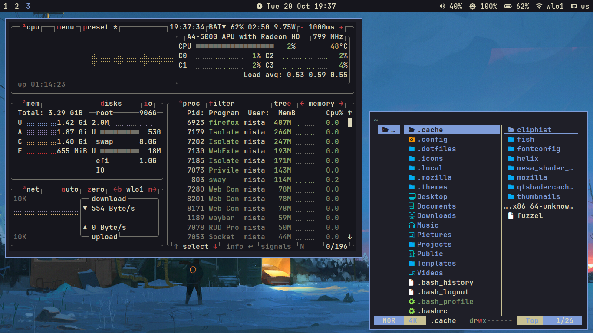
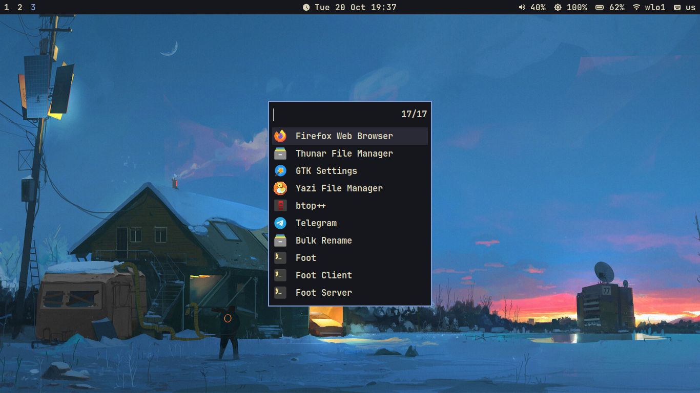

# swaydotfiles

**A lightweight, fast Wayland desktop on Void Linux, themed with the Kanagawa palette**

---

## What's Inside

| Component | Program |
|-----------|---------|
| Window Manager | `sway` |
| Bar | `waybar` |
| Terminal | `foot` |
| Launcher | `fuzzel` |
| Notifications | `mako` |
| Font | `JetBrains Mono Nerd` |
| Wallpapers | `swaybg` |
| Lock screen | `swaylock` |
| Idle | `swayidle` |
| Power menu | `wlogout` |
| Screenshots | `grim` + `slurp` |
| Clipboard | `cliphist` + `wl-clipboard` |
| Brightness | `brightnessctl` |
| Audio | `pipewire` |
| Shell | `fish` |
| Editor | `helix` |
| File managers | `yazi`, `Thunar` |
| Media | `mpv`, `kew` |

---

## Keybindings

| Shortcut | Action |
|----------|--------|
| `Super + Enter` | Terminal (foot) |
| `Super + D` | Launcher (fuzzel) |
| `Super + Q` | Close window |
| `Super + Shift + C` | Reload sway config |
| `Super + 1…9` | Switch workspace |
| `Super + Shift + 1…9` | Move window to workspace |
| `Super + F` | Fullscreen |
| `Super + X` | Clipboard |
| `Super + P` | Power menu | 
| `Print` | Screenshot |
| `Shift+Print` | Screenshot of area |

> Other keybinds you can find in `~/.config/sway/config` file.

---

## Future plans

- Create Telegram theme in Kanagawa palette
- Create GTK theme in Kanagawa palette

---

If you find this repo useful, consider leaving a star!
