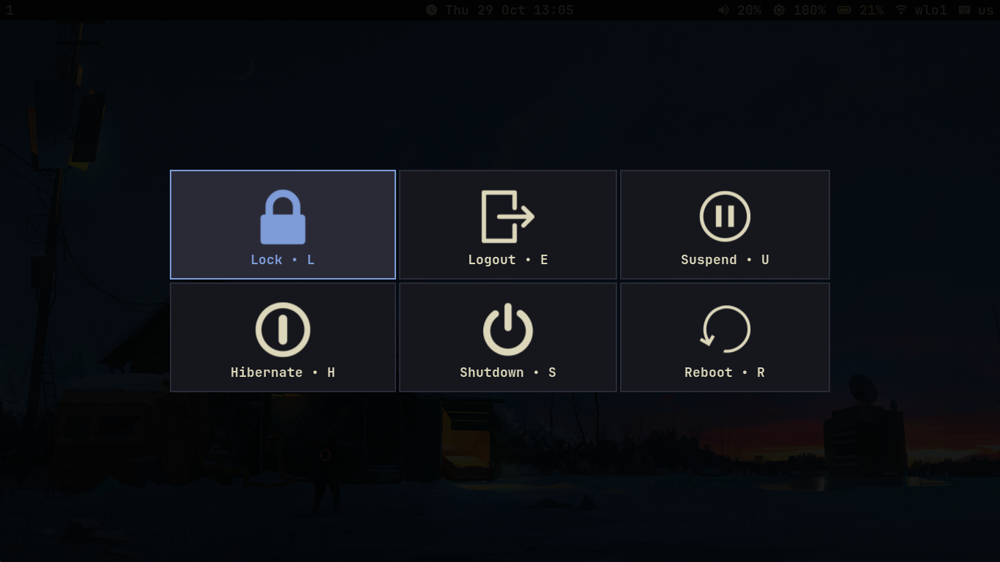

# swaydotfiles

**A simple and beatiful Sway rice in kanagawa palette**

---

## What's Inside

| Component | Program |
|-----------|---------|
| Window Manager | `sway` |
| Bar | `waybar` |
| Terminal | `foot` |
| Launcher | `fuzzel` |
| Notifications | `mako` |
| Font | `JetBrains Mono Nerd` |
| Wallpapers | `swaybg` |
| Lock screen | `swaylock` |
| Idle | `swayidle` |
| Power menu | `wlogout` |
| Screenshots | `grim` + `slurp` |
| Clipboard | `cliphist` + `wl-clipboard` |
| Brightness | `brightnessctl` |
| Shell | `fish` |
| Editor | `helix` |
| File manager | `yazi` |

---

## Warning!

Before installing config's you should in some config's change path and smth else, like a screen output to work properly.

---

If you find this repo useful, consider leaving a star!
